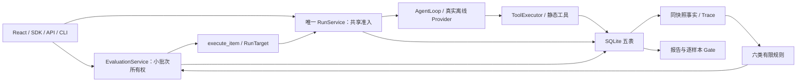

# Krim Agent

Krim Agent 是用于研读和求职讲述的 Python 模块化单体：从一个真实 Run 理解模型/工具循环、审批、取消、持久事实和脱敏 Trace，再用显式人工参考完成小批次版本评测。默认目标是确定性离线脚本，不发送模型网络请求，不代表商业模型质量。

LC-M1 和 React/shadcn UI 已在 `f841567656af8d3d0536c1636fcc6401768d81fb` 基线验收。本分支的 LC-M2 是按独立 评审 批准方案实现的待审候选，实际命令、首轮失败、修复、发行身份和限制见 [M2 实测报告](docs/agent-core/LC-M2-REPORT.md)。方案批准、实现方 自验和最终独立代码/视觉验收是不同结论。



## 运行与阅读

支持 Linux、Python 3.12、单进程单写端。先安装本轮实际 wheel（Python 分发包），再显式指定合成或自有私有数据库路径；不自动加载 `.env`。`KRIM_AGENT_API_KEY` 设置实例密钥；无密钥时只允许回环客户端/Host，浏览器保持同源。

```bash
# pip：Python 包安装工具；示例路径需替换为实际候选包。
python -m pip install /path/to/krim_agent-0.2.0a1-py3-none-any.whl
# -m 是 module（模块入口），serve 提供本机服务。
python -m krim_agent serve --database .data/agent-demo.db --port 8765
# CLI（Command-Line Interface，命令行界面）；key 是原请求幂等键。
krim run --url http://127.0.0.1:8765 --text '/add 2 3' --key demo-add
# result 只读原 ID（identifier，标识符），不会恢复或重放任务。
krim result --database .data/agent-demo.db --id <原Run-ID>
```

浏览器打开 `http://127.0.0.1:8765/ui/`。任务页支持 `/add 2 3`（两个模型步、一次真实 add）、`/echo 你好`、需要审批的 `/note welcome` 和演示停止的 `/slow`。评测页可显式选取已完成任务的输入，人工填写参考与理由、加入样本、冻结修订，再运行 `target-v1/v2/bad` 并比较报告。观测答案不会自动变成参考。

SDK（Software Development Kit，软件开发工具包）完整阅读入口是 [agent_demo.py](examples/agent_demo.py) 与 [agent_eval.py](examples/agent_eval.py)。建议沿 `composition → EvaluationService → execute_item → RunService → AgentLoop → ToolExecutor → RunSnapshot → scorers → gate_reports` 阅读。[M2 方案](docs/agent-core/LC-M2-PLAN.md)保存获批契约和取舍；[现状文档](docs/agent-core/ARCHITECTURE_CURRENT.md)区分历史架构与当前实现。

## 评测的含义

- 最多8个样本、重复1–3次、最多24个 item，串行执行，一个活跃 Eval。交互任务和所有评测版本共用默认4个 Run 名额，不按版本扩容。
- Candidate 保存来源资格、原 `source_run_id` 与指纹；Reference 必须显式填写 expected（可为 JSON null）及人工理由；DatasetRevision 以 name/version 冻结，同内容幂等、异内容冲突。后续执行生成独立子 Run，不冒用来源 Run。
- v1 实际将加法参数向零取整，v2 保留小数，bad 对整数加法实际多加1；三者都经过 Provider 往返与真实工具。差异不来自换标签或修改评分。
- 六类规则为状态/错误码、文本精确匹配、JSON 匹配、JSON Schema、工具序列、轨迹。缺事实、未知用量保持 null/skipped/error，布尔不当数字。执行终态、评分覆盖与质量结果分别呈现。
- Gate 先核对同数据、规则、重复及执行配置；partial、零覆盖或不兼容为 invalid。候选逐样本退化即 fail，均分提高不能抵消；pass 只说明本次冻结数据与规则下未检测到退化。
- 本机 `eval start --database` 持同一个 Application 等终态；可捕获中断先等真实 producer/scorer 和资源关闭。需要立即返回 ID、独立 wait/cancel 时使用 `--url` 连接长驻服务；远端客户端退出不取消批次。本机独立 wait/cancel 在开库前拒绝，report/compare/get 为只读。

## 边界与兼容

工具仍限可信异步 add、echo、lookup_note；没有 Shell、文件写入、插件、任意代码或 OS 沙箱承诺。权限无授权即拒绝；审批绑定 Run/call/参数/工具身份；Hook 不能改写原结果。取消必须等实际任务/流收束，SSE（Server-Sent Events，服务端事件流）断开仅停止读侧。

SQLite 从Krim Agent准确 v1 两表事务升级为 v2 五表，增加 dataset_revisions/evaluations/eval_items；未知或外来库仍拒绝。只读打开不会初始化、迁移、恢复或补写。写端重启将未完成执行记为 interrupted/partial，不续跑、不补评分。intent-only 仍不能证明工具已执行或未执行，也不补成功 Span。

私有结果包含原文本；脱敏 Trace 只展示允许字段。创建回程未知只按原键核实；首次精确未准入拒绝允许纠正后显式提交，不从一次 GET404 推断未执行。用户数据按文本渲染，无 HTML/Markdown 执行通道。

旧 AgentManager、Conversation/lease、兼容 HTTP Provider、模型评委、JSON 导入导出、离线 rescore、多 worker、持续采集/训练与 M3 均未交付。本轮不追旧 P01–P10/62项，不承诺 Windows、其它 Python/浏览器、商业模型或生产部署。M1/UI 历史失败及通过口径分别见原报告，不累计成 M2 通过数。
